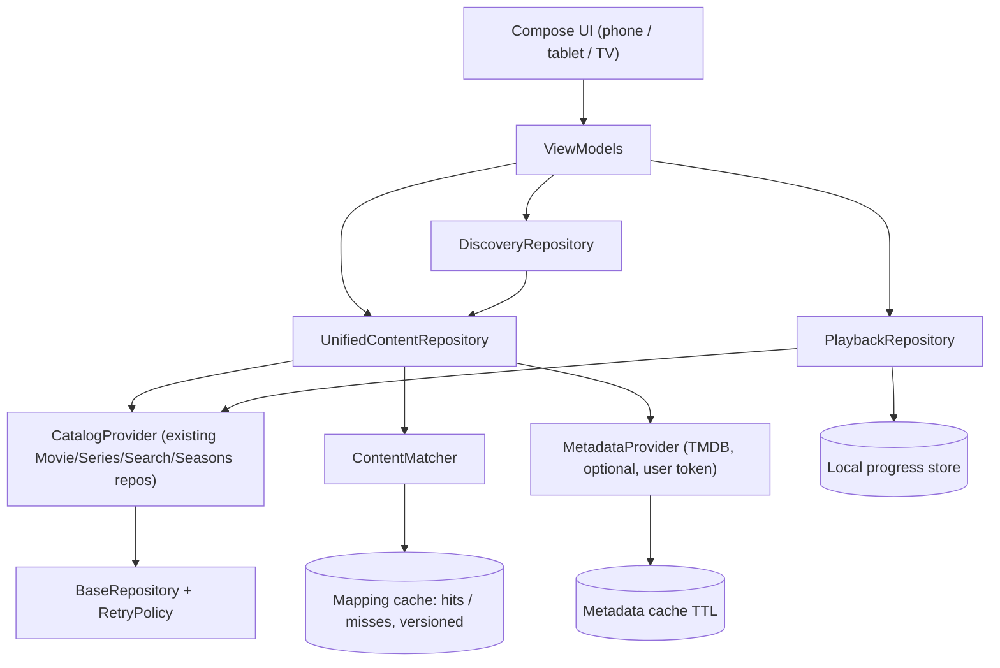

# CCloud Cinematic Edition — Implementation Plan

Master spec: [`CCloud_Cinematic_Codex_Implementation_Prompt.md`](../CCloud_Cinematic_Codex_Implementation_Prompt.md).
Branch: `feature/cinematic-discovery` (from `master` @ baseline commit recorded in `CINEMATIC_PROGRESS.md`).

## 1. Audit findings (primary repo, verified from source)

| Area | Finding |
|---|---|
| Stack | Kotlin 2.0.21, AGP 8.9.2, Gradle 8.11.1, Compose BOM 2024.09, Material3, Navigation-Compose 2.8.7, Media3 1.4.1 (exo/ui/hls/dash), OkHttp 4.12, kotlinx-serialization 1.6, Coil 2.7, Leanback 1.0. minSdk 24, target/compile 36. Single `:app` module. |
| Catalog API | **Not the 30nama API.** All content comes from `server-hi-speed-iran.info/api/...` with helper fallback hosts (`hostinnegar.com`, `windowsdiba.info`) and a hardcoded path API key in `BaseRepository`. No auth/session/subscription/login exists in the app. Spec items about "30nama auth/session" are therefore N/A for this codebase; we preserve the existing provider exactly. |
| Networking | `BaseRepository.executeRequest`: 30 s timeouts, primary→helper host failover, no retry/backoff, raw exception strings bubble up to UI. |
| Navigation | `AppNavigation` NavHost: Splash → `movies` (start), `series`, `search`, `favorites`, `settings`, `about`, `single_movie/{id}`, `single_series/{id}`, `country/{id}`. Bottom bar on phone, `SidebarNavigation` on TV (`DeviceUtils`). |
| Player | `VideoPlayerActivity` (1.4k lines, Compose + Media3): URL via intent extras, series/season/episode ids, seek ±10 s, retry-with-position, subtitle settings from `StorageUtils`. **No persistent resume position.** |
| Storage | JSON files in `filesDir` (`favorites.json`, `favorite_groups.json`, `subtitle_settings.json`, per-title cache files), `theme_prefs` SharedPreferences. No Room/DataStore. |
| i18n/RTL | English strings only; `android:supportsRtl="false"`; Vazirmatn fonts already bundled. |
| Security | `usesCleartextTraffic="true"`; hardcoded catalog API key (shipped in APK — extractable by design, not a secret). |
| Tests | **None** (no `src/test`, no `src/androidTest`). |

## 2. Reference repositories — decision matrix

| Repo / file | Decision | Reason |
|---|---|---|
| vhdmsm/CCloud `utils/PlaybackPositions.kt` | **Adapt** | Fits exactly (same codebase lineage, MIT). Ported thresholds into pure `core/playback/PlaybackProgress.kt`; storage added later in Phase C/E. |
| vhdmsm/CCloud `player/DualSubtitle*`, `ExternalSubtitleStore`, `SubtitleTracks` | **Defer → evaluate Phase F** | Valuable, but touches the renderer pipeline; needs player regression coverage first. |
| vhdmsm/CCloud `player/OpenSubtitlesClient` | **Defer** | Requires user API key + ToS review; optional only. |
| vhdmsm/CCloud `RankedMovieRepository`, `WatchmodeClient`, `OmdbClient`, `DataUsage` | **Reject for core / defer optional** | Chains paid/quota'd services into list loading; violates "Home must not depend on 5 services". Ranking ideas (log-scaled vote weighting) may inform Phase E local ranking. |
| vhdmsm/CCloud `components/TvFocus.kt`, `player/HoldSeek.kt` (+tests) | **Adapt (Phase C/F)** | Small, focused TV/D-pad helpers with tests. |
| vhdmsm/CCloud `SiteListCache` (+test) | **Design inspiration** | Bounded cache pattern. |
| 30nama-tizenos `tizen-app/js/tmdb.js` matching (`norm`, `sim`, `bestCand`, IMDb `/find` first) | **Port/adapt** | Ported to `core/matching/ContentMatcher.kt` with stricter rules: type gating, ambiguity margin, hard reject for movie year diff >1, Persian/Arabic folding, versioned results. |
| 30nama-tizenos `tmdb.js` TTLs (details 7d, trend 6h, match 7d, miss 24h), LRU + in-flight coalescing | **Adapt (Phase D)** | Sound volatility-based TTLs; will be implemented in Kotlin cache layer. |
| 30nama-tizenos `design/DESIGN.md` ("One Stage", near-black, single accent, Vazirmatn, restrained motion) | **Design inspiration** | Drives `core/designsystem` tokens. No assets copied. |
| 30nama-tizenos `api.js` (30nama API) | **Reject** | Different backend than this app; no authorized integration exists here. |
| thesaikodelik/30nama-apps (Swift/C#) | **Design inspiration only** | Home/detail layout, profile/progress concepts. No code port (different platforms). |

All three references are MIT; adapted logic is credited in file headers and `THIRD_PARTY_NOTICES.md` (Phase F).

## 3. Architecture (target)

Invariants: only `CatalogRef`-backed items can be `Availability.Playable`; TMDB data is enrichment only; every `Rating` carries kind + reporter.

## 4. Feature matrix (status tracked in `CINEMATIC_PROGRESS.md`)

| Feature | Phase | Depends on |
|---|---|---|
| Baseline build/test, env workarounds | A | — |
| Domain models, availability, ratings w/ source | B | — |
| Matcher + normalizer + tests | B | — |
| Progress math, retry/backoff, failure classes | B | — |
| Design tokens + core components | B | — |
| Cinematic Home (catalog rails, hero, continue watching) | C | B |
| Adaptive nav (bottom bar / rail / TV sidebar) | C | B |
| TMDB provider, cache, details enrichment | D | B |
| Explore/search/filters, My List, local personalization | E | C, D |
| Player polish, subtitles, TV hardening, docs, CI | F | all |

## 5. Defaults chosen (no confirmation needed)
- Keep brand "CCloud"; keep existing catalog provider and hosts.
- TMDB disabled unless a user supplies a token in Settings (stored locally; documented as not secret-grade in a shipped APK). No backend proxy.
- Watchmode/OMDb/OpenSubtitles: not in core paths.
- Progress stored locally only (no verified sync API).
- Room deferred until a cache needs relational queries (Phase D); existing JSON favorites kept as-is and read through mappers (no migration needed yet).
